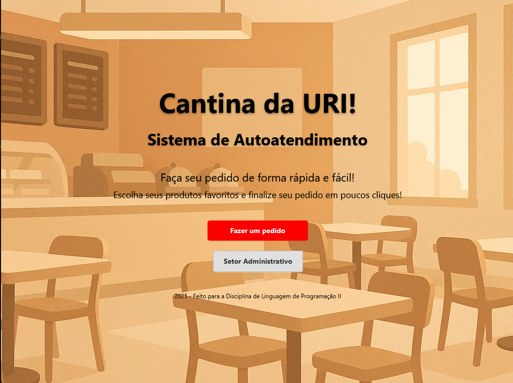
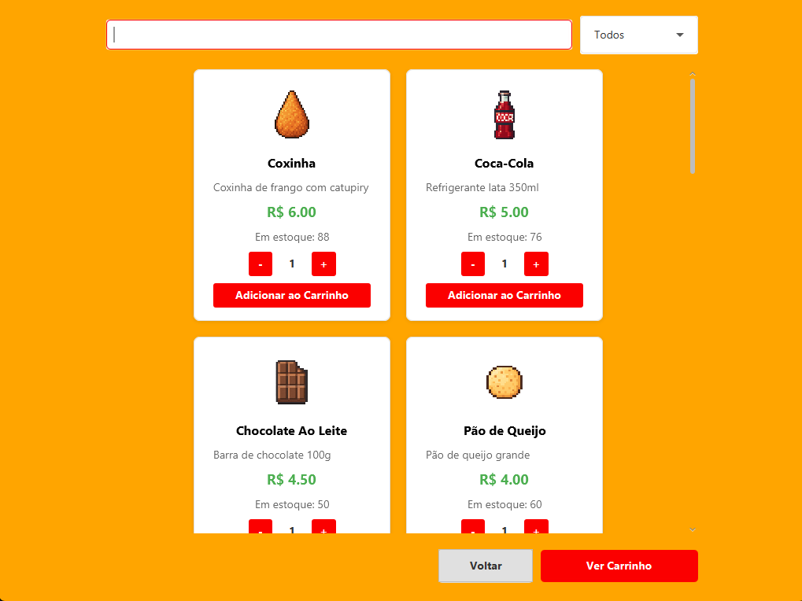
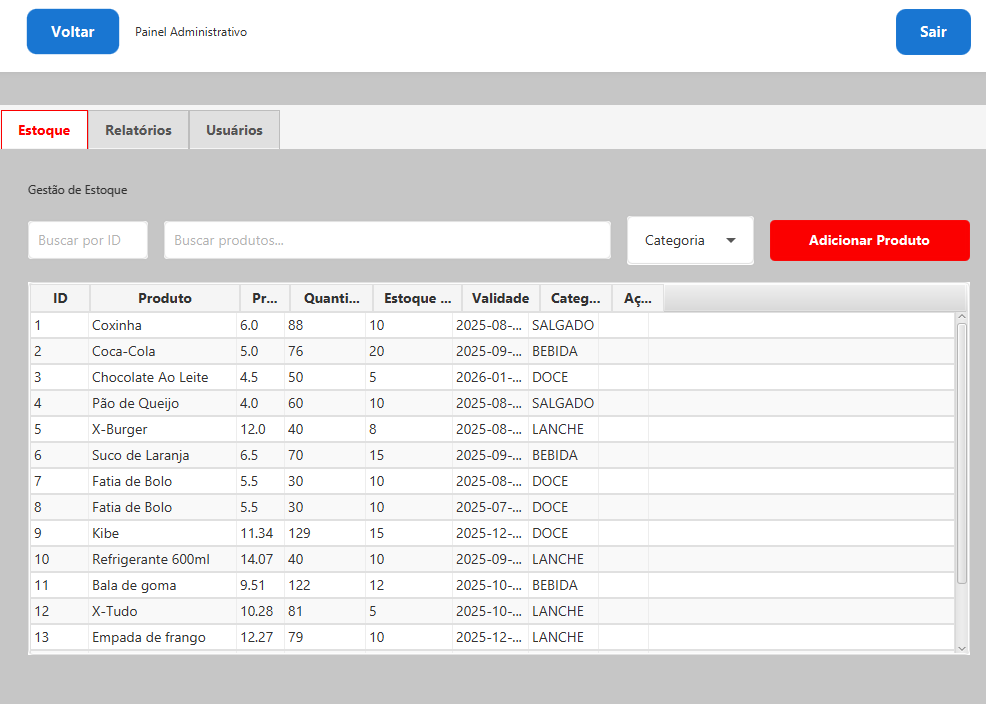
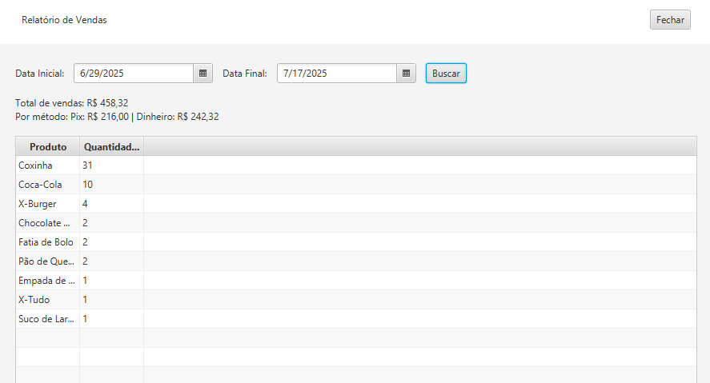
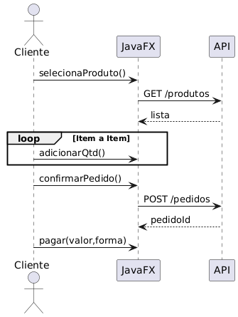
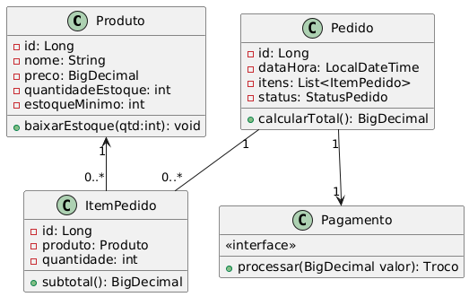
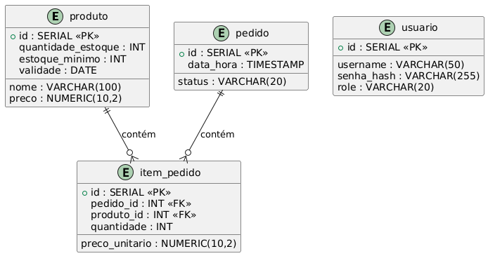
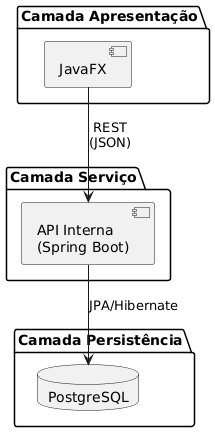

# Cantina Self-Service

Projeto academico de um sistema de autoatendimento para cantina universitaria, desenvolvido com **Spring Boot** e **JavaFX**. A aplicacao concentra fluxo de pedido, pagamento, administracao de produtos e relatorios operacionais em uma unica base.

**Curso:** Ciencia da Computacao (URI Santo Angelo)<br/>
**Disciplina:** Linguagem de Programacao III<br/>
**Professor:** Prof. Denilson Rodrigues da Silva<br/>
**Autores:** Thiago Ruiz e Guilherme Marschall

## Visao geral

O sistema foi pensado como um terminal digital de autoatendimento para uso em cantinas universitarias. A camada de negocio e persistencia roda com Spring Boot, enquanto a experiencia do usuario foi implementada em JavaFX.

Principais capacidades do prototipo:

- cadastro e consulta de produtos;
- montagem e confirmacao de pedidos;
- simulacao de pagamento e calculo de troco;
- autenticacao administrativa;
- relatorios de vendas, estoque baixo, validade e horario de pico.

## Stack e estrutura

- **Java 17**
- **Spring Boot 3.2.3**
- **JavaFX 21**
- **Maven Wrapper**
- **H2** como banco local em arquivo

Estrutura principal do repositorio:

- `cantinasa/`: codigo-fonte da aplicacao, recursos JavaFX e configuracoes Maven.
- `docs/diagramas/`: diagramas de arquitetura, classes, banco e caso de uso.
- `README.md`: visao geral do projeto e instrucoes de execucao.

## Telas do sistema

<p align="center">
  
  <br/><em>Tela inicial</em>
</p>

<p align="center">
  
  <br/><em>Secao de produtos</em>
</p>

<p align="center">
  
  <br/><em>Fluxo de compra</em>
</p>

<p align="center">
  
  <br/><em>Fluxo complementar</em>
</p>

## Diagramas

### Arquitetura



Padroes observados no projeto:

- MVC na camada JavaFX;
- DTOs e mappers para transporte de dados;
- separacao entre controller, service, repository e model.

### Modelagem de dominio



### Esquema de banco



### Caso de uso principal

| Atores | Fluxo principal |
|--------|-----------------|
| Cliente | 1. Seleciona categoria e produto.<br>2. Ajusta quantidades.<br>3. Confirma pedido.<br>4. Realiza pagamento.<br>5. Recebe comprovante. |



## Como executar

### Requisitos

- Java 17
- Permissao para abrir interface grafica JavaFX

### Build

```bash
cd cantinasa
./mvnw clean package
```

No Windows, use `mvnw.cmd`.

### Execucao local

```bash
cd cantinasa
./mvnw spring-boot:run
```

A aplicacao sobe o contexto Spring e abre a interface JavaFX. O banco H2 local e criado em `cantinasa/data/`.

### Dados iniciais

O projeto carrega dados de exemplo a partir de `src/main/resources/data.sql`, incluindo usuarios, produtos, pedidos e pagamentos. Uma credencial administrativa de teste presente nesse arquivo e:

- usuario: `admin@admin`
- senha: `admin`

## Documentacao do codigo

As classes principais ja possuem JavaDoc no codigo-fonte. Isso ajuda na navegacao da base e complementa esta documentacao de alto nivel.
